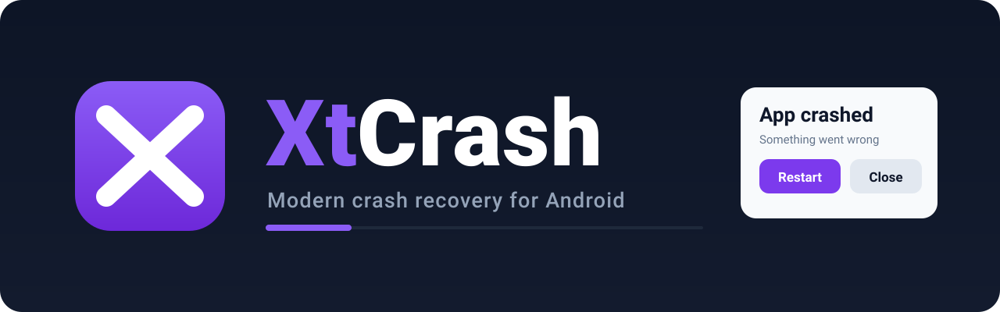

<p align="center">
  
</p>

<p align="center">
  <a href="LICENSE"></a>
  <a href="https://jitpack.io/#SoufianoDev/XtCrash"></a>
  
  
  
</p>

An Android library that replaces the default crash dialog with a configurable error screen: restart, close, technical details, copy to clipboard, crash report sharing, and per-crash IDs. The sources are Kotlin; the public API is Java-callable without changes.

XtCrash is built on top of [CrashX](https://github.com/TutorialsAndroid/crashx), which in turn is built on top of [CustomActivityOnCrash](https://github.com/Ereza/CustomActivityOnCrash). See [Attribution](#attribution).

## Table of Contents

- [Requirements](#requirements)
- [Installation](#installation)
- [Quick Start](#quick-start)
- [Configuration](#configuration)
- [Custom Error Screen](#custom-error-screen)
- [Jetpack Compose](#jetpack-compose)
- [Crash Reports](#crash-reports)
- [Event Listener](#event-listener)
- [R8 Minification](#r8-minification)
- [Documentation](#documentation)
- [Architecture](#architecture)
- [Contributing](#contributing)
- [Attribution](#attribution)
- [License](#license)

## Requirements

- Android API 23 or newer (`minSdk 23`)
- Any Android consumer setup that resolves the AAR; the Kotlin standard library ships transitively in the POM, so Java-only projects need no Kotlin plugin
- To build from source: JDK 21, Android SDK with `compileSdk 37`, the bundled Gradle 9.4.1 wrapper, AGP 9.2.1 (Kotlin support is built in, no extra plugin)

## Installation

### JitPack

Resolve coordinates `com.github.SoufianoDev.XtCrash:xtcrash:v1.0.0`. JitPack builds this once the `v1.0.0` tag exists on the repository; no tag has been published yet, so treat the coordinates as ready once tagging happens. Sub-module artifacts follow each module's publish metadata (`xtcrash`, `xtcrash-compose`), independent of directory names.

On JitPack the group mirrors the repository path (`com.github.USER.REPO:MODULE`), which is why the repo name appears in the group next to each artifact id. After the first tag, confirm the exact resolved names on [JitPack's artifact list](https://jitpack.io/#com.github.SoufianoDev/XtCrash/1.0.0).

Add the repository in your root `settings.gradle.kts`:

```kotlin
dependencyResolutionManagement {
    repositoriesMode.set(RepositoriesMode.FAIL_ON_PROJECT_REPOS)
    repositories {
        google()
        mavenCentral()
        maven { url = uri("https://jitpack.io") }
    }
}
```

Add the dependency in your app module:

```kotlin
dependencies {
    implementation("com.github.SoufianoDev.XtCrash:xtcrash:v1.0.0")
}
```

Groovy DSL equivalent:

```gradle
dependencies {
    implementation 'com.github.SoufianoDev.XtCrash:xtcrash:v1.0.0'
}
```

### Build from source

```bash
git clone https://github.com/SoufianoDev/XtCrash.git
cd XtCrash
./gradlew :library:assembleRelease
```

The AAR is written to `library/build/outputs/aar/`.

## Quick Start

The library installs itself. `CrashInitProvider`, declared in the library manifest, runs as a content provider at app startup and installs an uncaught-exception handler before `Application.onCreate()`.

Configure once in your `Application` class:

```kotlin
class MyApplication : Application() {
    override fun onCreate() {
        super.onCreate()
        CrashConfig.Builder.create()
            .enabled(true)
            .showErrorDetails(true)
            .trackActivities(true)
            .showReportButton(true)
            .supportEmail("support@example.com")
            .apply()
    }
}
```

The same configuration from Java:

```java
public class MyApplication extends Application {
    @Override
    public void onCreate() {
        super.onCreate();
        CrashConfig.Builder.create()
                .enabled(true)
                .showErrorDetails(true)
                .trackActivities(true)
                .showReportButton(true)
                .supportEmail("support@example.com")
                .apply();
    }
}
```

Imports: `io.github.soufianodev.xtcrash.CrashActivity` and `io.github.soufianodev.xtcrash.config.CrashConfig`.

Force a crash to see the error screen:

```java
throw new RuntimeException("Test crash");
```

## Configuration

Core options and their defaults as defined in `CrashConfig`:

| Option | Type | Default | Description |
|---|---|---|---|
| `enabled` | Boolean | `true` | Master switch; disable in debug builds or experiments when needed |
| `showErrorDetails` | Boolean | `true` | Shows the technical-details button and dialog |
| `showRestartButton` | Boolean | `true` | Restart button; restart target is looked up from the manifest when not configured |
| `showCloseButton` | Boolean | `true` | Close button that exits the app |
| `backgroundMode` | Int | `BACKGROUND_MODE_SHOW_CUSTOM` | `SHOW_CUSTOM` shows the screen on background crashes, `SILENT` closes the app, `CRASH` delegates to the previous handler |
| `trackActivities` | Boolean | `false` | Records an activity lifecycle log before the crash, capped at `maxActivityLogEntries` |
| `minTimeBetweenCrashesMs` | Int | `3000` | Crash-loop guard: repeated crashes inside this window are not shown again |
| `logErrorOnRestart` | Boolean | `true` | Gates the restart-time event (the previous stack trace re-logged when the error screen opens); reaches logcat only when `loggingEnabled` is on, and your listener when attached |
| `loggingEnabled` | Boolean | `false` | Opt-in logcat output for the library's own install and crash messages; the library is silent by default |
| `logListener` | `CrashLogListener` | `null` | Optional sink feeding the same messages into your own logging framework |
| `errorTitle` | String | `"Something went wrong"` | Screen title |
| `errorMessage` | String | `"The app ran into an unexpected problem. You can restart the app or send a crash report."` | Screen message |
| `showReportButton` | Boolean | `false` | Report/share button; combine with `supportEmail()` |
| `showCrashId` | Boolean | `true` | Displays the generated crash ID on the screen |
| `crashIdPrefix` | String | `"XTCRASH"` | Prefix for generated crash IDs |

Advanced options, all set through the same builder: custom labels for every button (`restartButtonText()`, `closeButtonText()`, `detailsButtonText()`, `reportButtonText()`, `copyButtonText()`), nine theme colors (`backgroundColor()`, `cardBackgroundColor()`, `primaryButtonColor()`, `secondaryButtonColor()`, `titleTextColor()`, `messageTextColor()`, `buttonTextColor()`, `secondaryButtonTextColor()`, `metaTextColor()`), a custom error icon (`errorDrawable()`), a custom restart target (`restartActivity()`), screen detail toggles (`showCopyButtonInDetails()`, `showAppInfo()`), report metadata toggles (`includeDeviceInfo()`, `includeActivityLog()`, `includeStackTrace()`, `includeBuildDate()`, `includeCrashId()`), report size limits (`maxStackTraceSize()`, default `131071`, and `maxActivityLogEntries()`, default `50`), and extra report text (`additionalReportInfo()`).

Every option reads back for building a UI from the current state: `CrashConfig.Builder.create()` starts from a copy of the current config, so sequential `apply()` calls keep previously applied settings unless overwritten.

## Custom Error Screen

Ship your own crash screen by subclassing and declaring the activity in the manifest on a separate process:

```xml
<activity
    android:name=".MyCrashActivity"
    android:process=":error_activity"
    android:exported="false" />
```

```kotlin
CrashConfig.Builder.create()
    .errorActivity(MyCrashActivity::class.java)
    .apply()
```

Static helpers on `CrashActivity` unpack the crash payload from the intent:

| Method | Returns |
|---|---|
| `CrashActivity.getConfigFromIntent(Intent)` | The serializable `CrashConfig` |
| `CrashActivity.getCrashIdFromIntent(Intent)` | Crash ID |
| `CrashActivity.getStackTraceFromIntent(Intent)` | Stack trace |
| `CrashActivity.getActivityLogFromIntent(Intent)` | Activity lifecycle log |
| `CrashActivity.getThreadNameFromIntent(Intent)` | Crashing thread name |
| `CrashActivity.getThrowableClassFromIntent(Intent)` | Exception class name |
| `CrashActivity.getThrowableMessageFromIntent(Intent)` | Exception message |
| `CrashActivity.getCrashDateFromIntent(Intent)` | Crash timestamp |
| `CrashActivity.getAllErrorDetailsFromIntent(Context, Intent)` | Combined details string |
| `CrashActivity.restartApplication(Context, CrashConfig)` | Restart the app |
| `CrashActivity.restartApplicationWithIntent(Context, Intent, CrashConfig)` | Restart to a specific target |
| `CrashActivity.closeApplication(Context, CrashConfig)` | Exit the app |

### Any project setup

The custom screen needs only three things: the manifest entry above, one `errorActivity(...)` line, and your own activity — whatever the stack. Every `CrashActivity` intent helper and the whole `CrashConfig` builder are static and Java-callable, so no Kotlin is required in the consumer, and the manifest entry doesn't get any code either — it is plain XML.

| Project setup | Custom error screen |
|---|---|
| Java + XML | Java activity, your XML layout (snippet below) |
| Kotlin + XML | Same, written in Kotlin |
| Java + Kotlin + XML | Same; plain setup, no extra wiring |
| Java + Kotlin + Compose + XML | Drop-in `ComposeErrorActivity` (see Jetpack Compose), or your own Compose activity |
| Java + Compose | Drop-in `ComposeErrorActivity` from Java; a fully custom Compose design needs one Kotlin file (Compose is Kotlin-only) |

Custom screen from pure Java + XML:

```java
public class MyErrorActivity extends Activity {
    @Override
    protected void onCreate(Bundle savedInstanceState) {
        super.onCreate(savedInstanceState);

        CrashConfig config = CrashActivity.getConfigFromIntent(getIntent());
        String errorDetails = CrashActivity.getAllErrorDetailsFromIntent(this, getIntent());

        setContentView(R.layout.my_error_screen); // your XML, your design
        // Bind any action to the library helpers:
        // CrashActivity.restartApplication(this, config);
        // CrashActivity.closeApplication(this, config);
    }
}
```

Misconfigurations are flagged at configure time: when the configured activity is missing from the merged manifest, or lacks its own `android:process`, the library logs a warning when the config is applied instead of failing silently during a crash.

## Jetpack Compose

Compose apps are supported out of the box: install, crash catching, tracking and the default screen work unchanged, and the core library carries no Compose dependency.

For a crash screen rendered in Compose, the optional `xtcrash-compose` artifact provides two levels of use:

**Drop-in (no code beyond one config line).** The artifact ships `ComposeErrorActivity`, a hosted crash activity in its own dedicated process, ready for any project:

```kotlin
dependencies {
    implementation("com.github.SoufianoDev.XtCrash:xtcrash-compose:1.0.0") // resolves with the same tag as the core
}
```

```kotlin
CrashConfig.Builder.create()
    .errorActivity(ComposeErrorActivity::class.java)
    .apply()
```

No manifest entry and no crash-activity code needed — the declaration ships inside the artifact and merges into your manifest.

**Config-driven composable.** `XtCrashErrorScreen` mirrors the default screen. It is driven entirely by `CrashConfig` — colors, labels, crash ID, the error details dialog, copy to clipboard and report sharing behave exactly like the XML screen — and it reuses the core string resources, so translations apply.

Point `errorActivity()` at your own `ComponentActivity`, then render the screen from the crash intent:

```kotlin
class ComposeCrashActivity : ComponentActivity() {
    override fun onCreate(savedInstanceState: Bundle?) {
        super.onCreate(savedInstanceState)
        val config = CrashActivity.getConfigFromIntent(intent) ?: run { finish(); return }
        setContent {
            XtCrashErrorScreen(
                config = config,
                errorDetails = CrashActivity.getAllErrorDetailsFromIntent(this, intent),
                crashId = CrashActivity.getCrashIdFromIntent(intent) ?: "",
            )
        }
    }
}
```

Restart and close buttons call `CrashActivity.restartApplication(...)` and `closeApplication(...)` internally; you only need the screen in `setContent`.

### Build your own screen

`XtCrashErrorScreen` mirrors the default look. For a fully custom design, skip it and render any composable from the crash activity — the screen is an ordinary `ComponentActivity`:

```kotlin
class ComposeCrashActivity : ComponentActivity() {
    override fun onCreate(savedInstanceState: Bundle?) {
        super.onCreate(savedInstanceState)
        val config = CrashActivity.getConfigFromIntent(intent) ?: run { finish(); return }
        setContent { MyAppCrashScreen(config) }
    }
}

@Composable
fun MyAppCrashScreen(config: CrashConfig) {
    val activity = LocalContext.current as? Activity ?: return
    // Your UI, your styling — config colors and labels are optional. Restart and close
    // stay library calls so the config's restart intent and close policy are applied:
    Column {
        Button(onClick = { CrashActivity.restartApplication(activity, config) }) { Text("Restart") }
        Button(onClick = { CrashActivity.closeApplication(activity, config) }) { Text("Close") }
    }
}
```

## Crash Reports

When `showReportButton(true)` is applied, the screen shows a share action. With `supportEmail()` set, the share intent is prepared as an email using `reportSubject()` and `reportChooserTitle()`; without one, the share sheet offers all available targets. Attach extra context with `additionalReportInfo()`.

The report can include: crash ID, package name, app version, library version (`CrashActivity.VERSION`), Android version, API level, device model, brand, manufacturer, crash date, crashing thread, exception class and message, stack trace, build date, activity lifecycle log, and the custom `additionalReportInfo()` text. Each item is controlled by its `include*()` toggle.

Reports are assembled on device and shared through Android share intents. The library sends nothing on its own.

### Report destinations

By default the button uses the generic Android Sharesheet. `reportTo(...)` selects a specific destination instead. A destination never enables the button by itself — `showReportButton(true)` is still required — and no destination is ever guessed or auto-detected. When no destination is configured, the Sharesheet behavior above is unchanged.

| Destination | Builder call | What happens when the user taps the button |
|---|---|---|
| Sharesheet (default) | none | Generic Android Sharesheet, as before |
| `EMAIL` | `reportTo(ReportDestination.EMAIL)` | `ACTION_SENDTO` with a `mailto:` URI, so only email apps are offered. The recipient is suggested from `supportEmail()`; without one the user picks or enters it. Nothing is ever sent automatically. |
| `GITHUB` | `reportTo(ReportDestination.GITHUB)` plus `githubIssueTarget(owner, repository)` | Opens the GitHub new-issue form with title and body prefilled |
| `GITLAB` | `reportTo(ReportDestination.GITLAB)` plus `gitLabIssueTarget(projectPath, baseUrl)` | Opens the GitLab new-issue form with title and description prefilled |
| `CUSTOM` | `reportTo(ReportDestination.CUSTOM)` plus `reportSender(sender)` | Calls your `ReportSender` implementation |

```kotlin
CrashConfig.Builder.create()
        .showReportButton(true)
        .reportTo(ReportDestination.GITHUB)
        .githubIssueTarget("your-org", "your-repo")
        .apply()
```

`githubIssueTarget` and `gitLabIssueTarget` require explicit values; the library never infers a repository or project from the package name. A missing target is reported as a configuration error at tap time (with the report still available to copy or share), not silently ignored. For self-hosted GitLab, pass the instance root (for example `https://gitlab.example.com`) — a base URL with a path is rejected.

`clearReportDestination()`, `clearReportSender()`, and `clearReportActionHandler()` reset each independently.

### Long reports and URL limits

GitHub and GitLab accept only a limited URL length, so a very long report cannot be carried in the issue URL in full. XtCrash measures the complete percent-encoded URL in bytes (default budget 8000, override with `reportUrlBudgetBytes(n)`; a configured value below 512 is clamped up, so the floor cannot be bypassed) and shortens the *prefill projection* when it does not fit — never the canonical report, which stays complete.

When the prefill had to be shortened, the full report is copied to the clipboard and the confirmation dialog says so. If the clipboard copy fails, the dialog says that too instead of claiming a copy that did not happen. The user pastes the remainder into the issue form manually.

### Privacy confirmation for web destinations

Report content placed in a web URL can be transmitted to GitHub or GitLab before the user submits the issue. For that reason `GITHUB` and `GITLAB` always show a confirmation dialog naming the destination before the browser opens; the dialog shows exactly what the URL will carry. `EMAIL` does not add this step, because `ACTION_SENDTO` opens a draft the user reviews and sends themselves.

### Custom sender

`ReportDestination.CUSTOM` routes the report to your own `ReportSender`:

```kotlin
class MySender : ReportSender {
    override fun send(report: PreparedReport): ReportOutcome {
        // Use report.reportText, report.subject, report.url, report.crashId.
        return ReportOutcome.ACCEPTED
    }
}
```

The sender runs on a worker thread, bounded by `reportHandlerTimeoutMs` (default 5000 ms). It is invoked with an immutable `PreparedReport` snapshot; the canonical `reportText` is always complete, and `url` carries the exact encoded destination URL when one applies.

### Report action handler

An optional `ReportActionHandler` is offered the prepared report before the destination's normal action runs, letting an integration such as XtMapper accept responsibility for a crash report. It is configured by class rather than instance, because reporting runs in the `:xtcrash_error` process where an instance registered in the original process is not recoverable:

```kotlin
CrashConfig.Builder.create()
        .reportActionHandler(MyHandler::class.java)
        .apply()
```

The class must be public with a public no-argument constructor; the builder rejects anything else at configure time. Outcomes are interpreted distinctly and none of them ever starts a second flow automatically:

| Outcome | Meaning | What XtCrash does |
|---|---|---|
| `ACCEPTED` | Responsibility durably accepted | Stops; shows the accepted message |
| `NOT_HANDLED` | Declined | Runs the destination's normal action |
| `FAILED` | Definite failure before anything ran | Stops; offers the fallback |
| `UNKNOWN` | Uncertain (timeout or mid-flight exception) | Stops; offers the fallback. Never retried automatically, because acceptance may already have happened |

`UNKNOWN` is deliberately terminal: the handler may have accepted the report before failing, so an automatic retry could produce a duplicate.

### Limitations

- A stack trace truncated at capture time by `maxStackTraceSize()` cannot be restored by the report pipeline; the canonical report can only reflect what was captured.
- Handler and sender deadlines stop XtCrash from *waiting*, but cannot forcibly terminate a worker thread that is already running.
- URL byte budgets are a conservative default, not a universally verified service limit; self-hosted GitLab deployments vary.
- Device/emulator behavior (real browser handoff, real email clients, live GitHub/GitLab prefill) is not covered by the unit test suite, which runs on the JVM.

## Event Listener

Track error-screen flows by implementing `CrashActivity.EventListener`: `onLaunchErrorActivity()`, `onRestartAppFromErrorActivity()`, and `onCloseAppFromErrorActivity()`. Set it with `eventListener()`.

The listener is serialized with the crash config, so anonymous and non-static inner classes are rejected by the builder with an explanation. Use a top-level class or a static inner class.

The builder also rejects listeners whose declared instance fields are not `java.io.Serializable` (static, transient, and primitive fields are exempt), so a bad field is caught at configure time with its name instead of failing during a crash. The check cannot prove everything: a field declared as `Any`/`Object` or as an interface can still hold non-serializable state, so prefer concrete serializable types or mark uncertain fields `@Transient`. A `@Transient` field is left at its default and the listener's constructor is not re-run at deserialization, so callbacks must resolve such state when invoked (for example, by looking it up lazily) or reinitialize it explicitly.

## Logging

The library is silent by default and owns nothing beyond its own messages; where its diagnostics go is your decision:

- `loggingEnabled(true)` restores the previous logcat output (tag `XtCrash`, `Log.i`/`Log.w`/`Log.e`) for install and crash events.
- `logListener(...)` receives the same events with the standard `android.util.Log` priorities so they can enter your own framework, such as a file-based logger or `XtLogger`-style pipeline. The library only forwards; it never formats or stores them.
- Both sinks can be combined. `logErrorOnRestart` stays the gate for the restart-time stack trace. The sample app wires both together: `DemoCrashLogListener` in `xtcrash-sample` forwards every event under the `XtCrashDemo` tag with the delivering process's PID, making the cross-process delivery visible in logcat.

```kotlin
CrashConfig.Builder.create()
        .loggingEnabled(true) // logcat on its own
        .apply()
```

or, forwarding into the app's own logger:

```kotlin
CrashConfig.Builder.create()
        .logListener(ForwardingLogListener()) // top-level class
        .apply()
```

where the listener mirrors the `android.util.Log` signature:

```kotlin
class ForwardingLogListener : CrashLogListener {
    override fun onCrashLog(priority: Int, tag: String, message: String, throwable: Throwable?) {
        // Example hand-off: yourLogger.log(priority, tag, message, throwable)
    }
}
```

The listener is serialized with the crash config (the crash data moves into the `:xtcrash_error` process), so the same top-level/static-class rule and field-validation rules as `eventListener()` apply. Configure logging in `Application.attachBaseContext()` if you also want install-time messages.

## R8 Minification

The AAR ships `library/consumer-rules.pro`, so consuming apps get the keep rules automatically. No app-side configuration is needed for standard usage.

Custom features are serialized through intents (config, event listener). If your app runs aggressive shrinking and you use a custom error activity or event listener, keep those classes in your own rules as well.

A `ReportActionHandler` configured with `reportActionHandler(MyHandler::class.java)` is instantiated by reflection in the `:xtcrash_error` process, so R8 needs to keep it. The class name is referenced only through your config code, which shrinking can rewrite, so add an app-side rule:

```pro
-keep class com.example.MyHandler { public <init>(); }
```

## Documentation

Extended documentation is served by the Astro Starlight site in `docs/`, built
and published by the GitHub Pages workflow at
[https://soufianodev.github.io/XtCrash/](https://soufianodev.github.io/XtCrash/).
The Markdown sources live in `docs/src/content/docs/`.

| Page | Covers |
|---|---|
| [Introduction](https://soufianodev.github.io/XtCrash/introduction/) | What the library does, artifact map, non-goals |
| [Quick Start](https://soufianodev.github.io/XtCrash/quickstart/) | Install, configure, first test crash |
| [Configuration](https://soufianodev.github.io/XtCrash/configuration/) | Complete `CrashConfig` reference |
| [Custom Error Screen](https://soufianodev.github.io/XtCrash/custom-error-screen/) | Subclass, manifest entry, intent helpers |
| [Compose](https://soufianodev.github.io/XtCrash/compose/) | Drop-in activity, composable screen, custom designs |

## Architecture

```
library/src/main/java/io/github/soufianodev/xtcrash/
├── CrashActivity.kt              core: install(), config holder, intent helpers, statics
├── config/CrashConfig.kt         serializable config + fluent builder
├── activity/DefaultErrorActivity.kt   the default crash screen UI
└── provider/CrashInitProvider.kt      manifest-declared provider, installs the handler at startup
```

Flow: the provider installs an uncaught-exception handler, preserving any previously installed one (initialize XtCrash first, then Firebase Crashlytics, ACRA, or another handler, so the chain stays intact). A crash builds the serializable payload, then either launches the error activity or delegates by `backgroundMode`. The error activity runs in a dedicated `:xtcrash_error` process and survives the main process dying. `minTimeBetweenCrashesMs` prevents restart loops.

## Contributing

Development setup, build verification, review process, and code conventions: [CONTRIBUTING](CONTRIBUTING.md). Pull requests get an automated CodeRabbit review on open and on each new push; a human maintainer closes the merge. Security issues go by email to `contact@crashx.dev` rather than the public tracker.

## Attribution

XtCrash is built on top of **CrashX**, which in turn is built on top of **CustomActivityOnCrash**.

- [CustomActivityOnCrash](https://github.com/Ereza/CustomActivityOnCrash): the original library by **Eduard Ereza Martínez**, Apache License 2.0
- [CrashX](https://github.com/TutorialsAndroid/crashx): a maintained, modernized continuation of CustomActivityOnCrash
- XtCrash: this repository, a standalone continuation of the CrashX line

The [`NOTICE`](NOTICE) file records the derivative-work chain and the [`LICENSE`](LICENSE) file carries the Apache License 2.0 text. Both stay in the repository at distribution time.

## License

Apache License, Version 2.0. See [LICENSE](LICENSE).
